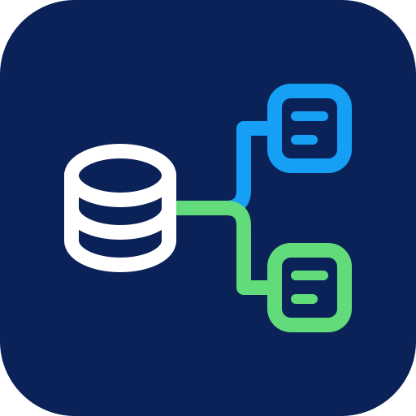

#  adorm

[](https://pypi.org/project/adorm/)
[](https://pypi.org/project/adorm/)
[](https://github.com/velis74/adorm/blob/main/LICENSE)

adorm (asynchronous database ORM, pronounced "adore") is a pure async ORM for Python: every call that touches the
database is a coroutine or returns an awaitable. Applications build queries and model operations with adorm's API; a
driver executes them, natively on the event loop (PostgreSQL through asyncpg) or through a synchronous database
library or ORM (Django). adorm's pool runs a synchronous library on a thread owned by one slot, with that slot's
connection, so the event loop never runs synchronous database code. The API is modelled on the Django ORM.

**Documentation: <https://docs.velis.si/adorm/>** ([quick start](https://docs.velis.si/adorm/intro/quickstart),
[API reference](https://docs.velis.si/adorm/ref/), [changelog](https://docs.velis.si/adorm/intro/changelog))

adorm is pre-alpha (0.0.x): the API can change in any release.

## Installation

```bash
pip install "adorm[django]"     # the Django ORM driver
pip install "adorm[asyncpg]"    # the native PostgreSQL driver: asyncpg, Django and psycopg 3
```

Both drivers need Python 3.11 or newer and Django 5.2 or newer: the native PostgreSQL driver compiles its SQL with
Django's query compiler.

## Example

```python
import adorm

from myapp.adorm_models import Activity, Member


async def rename_member(member_id: int, name: str) -> None:
    async with adorm.atomic():
        member = await Member.objects.get(pk=member_id)
        member.name = name
        await member.save()
        await Activity.objects.create(member_id=member.pk, kind="renamed")


async def active_names() -> list[str]:
    return [m.name async for m in Member.objects.filter(active=True).order_by("name")]
```

`myapp.adorm_models` is generated from the Django models with `adorm generate`; the
[quick start](https://docs.velis.si/adorm/intro/quickstart) sets up a project from start to finish.

## Development

The project uses [uv](https://docs.astral.sh/uv/). The test suite needs PostgreSQL; the conformance run on SQLite
needs no database server (Python's `sqlite3`).

```bash
uv sync
uv run ruff check .
uv run ruff format --check .
uv run pytest
npm install
npm run lint              # eslint, markdownlint and type checks of the demo; `npm run lint -- --fix` fixes
```

The tests read the test database URL from `ADORM_TEST_DATABASE_URL` (default
`postgres://postgres@127.0.0.1:5432/adorm_test`). On that server they create and drop the database it names
(`<name>`: `ADORM_TEST_DATABASE_NAME` when set, `adorm_test` when the URL names `postgres` or none) and the databases
`<name>_demo`, `<name>_demo_owner`, `<name>_limited`, `<name>_parallel` and `<name>_parallel_<n>` (the clones of
`manage.py test --parallel`). Other databases and the server's roles are left untouched; runs with different names
on one server leave each other's databases alone. A run that leaves any of these databases, or a role named
`<name>_…`, on the server fails. Run the tests as a dedicated user with `CREATEDB`. Under a
superuser the test of the pool's refusal handling is skipped, because a database's connection limit does not apply to
a superuser, and so are the tests of the demo, which refuses a superuser:

```sql
CREATE ROLE adorm LOGIN CREATEDB PASSWORD '...';
```

`ADORM_TEST_CREATE_ROLES=1` also runs the tests of the `role` connection option. They create and drop the roles
`<name>_login`, `<name>_alice` and `<name>_bob` and need `CREATEROLE`. Roles belong to the whole server and
outlive the test databases: set the variable only on a server dedicated to the tests. CI runs the suite with
`CREATEDB` only, then grants `CREATEROLE` and runs these tests separately.

The demo reads its database URL from `ADORM_DEMO_DATABASE_URL`. Both variables can be set in `.env` in the repository
root (ignored by git; `.env.example` lists them). Variables set in the environment take precedence.

```bash
cp .env.example .env    # then fill in the user and password
uv run pytest
```

The conformance suite also runs the Django driver on SQLite, in a database file in a temporary directory, without
PostgreSQL:

```bash
uv run pytest --ds=tests.djangoproject.settings_sqlite tests/conformance
```

## Demo

[`demo.py`](https://docs.velis.si/adorm/intro/demo) runs the demo application, a library on PostgreSQL: every example
and concurrency scenario on every available driver, with the adorm code, the SQL each driver sent, the result and the
time side by side.

[](https://codespaces.new/velis74/adorm?quickstart=1)

The codespace runs the demo with a PostgreSQL server of its own.

- `demo/backend`: a Django project with the app `library`;
- `demo/models`: the adorm models generated from it;
- `demo/api`: a FastAPI app running the examples and scenarios;
- `demo/frontend`: the Vue frontend; `demo/e2e`: its Playwright tests.

It creates (owned by the user of `ADORM_DEMO_DATABASE_URL`, which must not be a superuser), migrates and seeds the
demo database, then serves the API and the Vite dev server on <http://127.0.0.1:5173/>.

```bash
npm install
uv run python demo.py
npm run test:e2e
```

## Documentation

The documentation site is in `docs/` (VitePress, published on <https://docs.velis.si/adorm/>):

```bash
npm install
npm run docs:dev
```

## Licence

MIT, see [LICENSE](https://github.com/velis74/adorm/blob/main/LICENSE).
